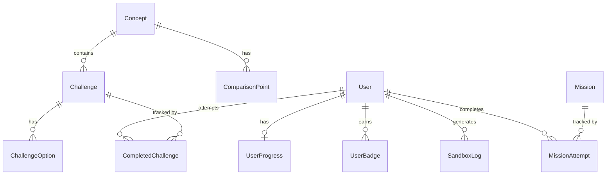
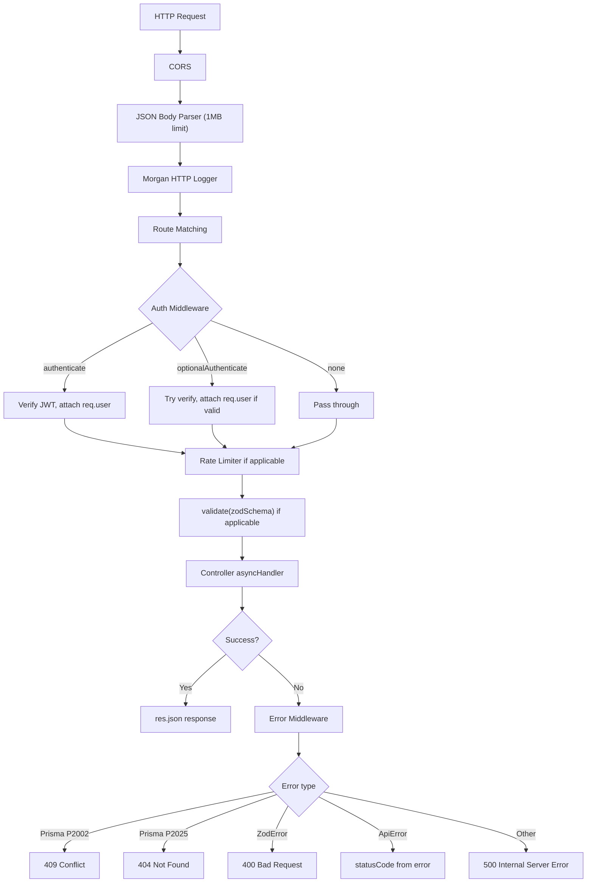

# API Quest — Backend Documentation

> Cross-references: [BACKEND_IMPLEMENTATION.md](./BACKEND_IMPLEMENTATION.md) | [SYSTEM_IMPLEMENTATION.md](../SYSTEM_IMPLEMENTATION.md)

---

## 1. Technology Stack

| Layer | Technology | Version |
|---|---|---|
| Runtime | Node.js | LTS |
| Framework | Express | ^4.19.2 |
| ORM | Prisma Client | ^5.14.0 |
| Database | PostgreSQL | Any modern version |
| Authentication | jsonwebtoken | ^9.0.2 |
| Password hashing | bcryptjs | ^2.4.3 |
| Validation | Zod | ^3.23.8 |
| HTTP client | Axios | ^1.7.2 |
| Rate limiting | express-rate-limit | ^7.3.1 |
| Request logging | Morgan | ^1.10.0 |
| Dev server | Nodemon | ^3.1.4 |

Module system: CommonJS (`'use strict'` throughout).

---

## 2. Project Folder Structure

```
backend/
├── prisma/
│   ├── schema.prisma          # Database schema (all models, enums, relations)
│   └── seed.js                # Database seed script
│
└── src/
    ├── server.js              # Entry point: Prisma connect, HTTP server start
    ├── app.js                 # Express app: CORS, body parser, Morgan, routes, error middleware
    │
    ├── config/
    │   ├── db.js              # Prisma singleton client
    │   └── env.js             # Environment variable loading and validation
    │
    ├── middlewares/
    │   ├── auth.middleware.js      # authenticate, optionalAuthenticate
    │   ├── error.middleware.js     # Centralised error handler
    │   └── validate.middleware.js  # Zod schema validation factory
    │
    ├── routes/
    │   └── index.js           # Mounts all module routers under /api
    │
    ├── modules/
    │   ├── auth/              # register, login, token refresh
    │   ├── users/             # GET /users/me
    │   ├── concepts/          # Learning concept catalogue
    │   ├── challenges/        # Quiz/challenge engine
    │   ├── missions/          # Interactive mission engine
    │   ├── sandbox/           # REST/GraphQL/SOAP proxy
    │   ├── progress/          # User XP, level, streak, badges
    │   └── leaderboard/       # Global rankings
    │
    └── utils/
        ├── ApiError.js        # Custom error class with static factory methods
        ├── asyncHandler.js    # Wraps async controllers to forward errors to next()
        └── logger.js          # Lightweight custom logger (4 levels, ISO timestamps)
```

Each module follows a consistent 4-file pattern:

| File | Responsibility |
|---|---|
| `*.routes.js` | Express Router: middleware chain, HTTP verb/path mapping |
| `*.controller.js` | Request/response: parse req, call service, send res |
| `*.service.js` | Business logic: orchestrates model calls, applies rules |
| `*.model.js` | Database access: all Prisma queries for that domain |

---

## 3. Environment Variables

Loaded via `src/config/env.js`. Required variables cause a thrown error at startup if absent.

| Variable | Required | Default | Description |
|---|---|---|---|
| `DATABASE_URL` | Yes | — | PostgreSQL connection string |
| `JWT_ACCESS_SECRET` | Yes | — | HMAC secret for access tokens |
| `JWT_REFRESH_SECRET` | Yes | — | HMAC secret for refresh tokens |
| `PORT` | No | `5000` | HTTP server port |
| `NODE_ENV` | No | `development` | Runtime environment |
| `JWT_ACCESS_EXPIRES_IN` | No | `15m` | Access token lifetime |
| `JWT_REFRESH_EXPIRES_IN` | No | `7d` | Refresh token lifetime |
| `SANDBOX_REST_BASE_URL` | No | `https://jsonplaceholder.typicode.com` | REST sandbox target |
| `SANDBOX_GRAPHQL_BASE_URL` | No | `https://countries.trevorblades.com/graphql` | GraphQL sandbox target |
| `SANDBOX_SOAP_BASE_URL` | No | `http://www.dneonline.com/calculator.asmx` | SOAP sandbox target |
| `RATE_LIMIT_WINDOW_MS` | No | `60000` | Sandbox rate limit window (ms) |
| `RATE_LIMIT_MAX_REQUESTS` | No | `30` | Max sandbox requests per window |

---

## 4. Database Schema

### 4.1 Enums

**Protocol**
```
REST | SOAP | GRAPHQL | AUTHENTICATION | PAGINATION |
RATE_LIMITING | SECURITY | WEBHOOKS | ERROR_HANDLING
```

**ChallengeType**
```
QUIZ | FIX_REQUEST | PREDICT_RESPONSE
```

**Difficulty**
```
EASY | MEDIUM | HARD
```

**MissionType**
```
DEBUGGER | EXPERIMENT | MISSION
```

**MissionDifficulty**
```
BEGINNER | EXPLORER | BUILDER | DEBUGGER_LVL | ADVANCED | BOSS
```

---

### 4.2 Models

#### User (`users`)
| Field | Type | Constraints |
|---|---|---|
| `id` | String (UUID) | PK, auto-generated |
| `email` | String | Unique |
| `username` | String | Unique |
| `passwordHash` | String | bcrypt, 12 rounds |
| `createdAt` | DateTime | default now() |

Relations: `UserProgress` (one-to-one), `UserBadge[]`, `CompletedChallenge[]`, `SandboxLog[]`, `MissionAttempt[]`

---

#### Concept (`concepts`)
| Field | Type | Constraints |
|---|---|---|
| `id` | String (UUID) | PK |
| `protocol` | Protocol enum | — |
| `title` | String | — |
| `slug` | String | Unique |
| `explanation` | String | — |
| `sampleEndpoint` | String | — |
| `createdAt` | DateTime | default now() |

Relations: `ComparisonPoint[]` (cascade delete), `Challenge[]` (cascade delete)

---

#### ComparisonPoint (`comparison_points`)
| Field | Type | Constraints |
|---|---|---|
| `id` | String (UUID) | PK |
| `conceptId` | String | FK → Concept, cascade delete |
| `label` | String | — |
| `value` | String | — |

---

#### Challenge (`challenges`)
| Field | Type | Constraints |
|---|---|---|
| `id` | String (UUID) | PK |
| `conceptId` | String | FK → Concept, cascade delete |
| `type` | ChallengeType enum | — |
| `question` | String | — |
| `xpReward` | Int | — |
| `level` | Int | default 1 |
| `requiredXp` | Int | default 0 — XP gate to unlock |
| `difficulty` | Difficulty enum | — |
| `explanation` | String? | Optional post-answer explanation |
| `createdAt` | DateTime | default now() |

Relations: `ChallengeOption[]` (cascade delete), `CompletedChallenge[]`

---

#### ChallengeOption (`challenge_options`)
| Field | Type | Constraints |
|---|---|---|
| `id` | String (UUID) | PK |
| `challengeId` | String | FK → Challenge, cascade delete |
| `optionText` | String | — |
| `isCorrect` | Boolean | — |

---

#### UserProgress (`user_progress`)
| Field | Type | Constraints |
|---|---|---|
| `userId` | String | PK, FK → User, cascade delete |
| `xpTotal` | Int | default 0 |
| `level` | Int | default 1 |
| `streakCount` | Int | default 0 |
| `lastActivity` | DateTime? | nullable |
| `missionsCompleted` | Int | default 0 |
| `bugsFixed` | Int | default 0 |
| `updatedAt` | DateTime | auto-updated |

---

#### UserBadge (`user_badges`)
| Field | Type | Constraints |
|---|---|---|
| `id` | String (UUID) | PK |
| `userId` | String | FK → User, cascade delete |
| `badgeCode` | String | — |
| `earnedAt` | DateTime | default now() |

Unique constraint: `(userId, badgeCode)` — a badge can only be awarded once per user.

**Available badge codes:**

| Code | Trigger |
|---|---|
| `rest_rookie` | First correct REST challenge |
| `soap_slinger` | First correct SOAP challenge |
| `graphql_guru` | First correct GraphQL challenge |
| `first_blood` | First correct challenge of any type |
| `century` | xpTotal reaches 100 |
| `legend` | xpTotal reaches 500 |

---

#### CompletedChallenge (`completed_challenges`)
| Field | Type | Constraints |
|---|---|---|
| `id` | String (UUID) | PK |
| `userId` | String | FK → User |
| `challengeId` | String | FK → Challenge |
| `completedAt` | DateTime | default now() |
| `isCorrect` | Boolean | — |

Unique constraint: `(userId, challengeId)` — upserted on each attempt; a user has one record per challenge.

---

#### SandboxLog (`sandbox_logs`)
| Field | Type | Constraints |
|---|---|---|
| `id` | String (UUID) | PK |
| `userId` | String? | FK → User, nullable (anonymous users allowed) |
| `protocol` | Protocol enum | REST, GRAPHQL, or SOAP |
| `requestPayload` | Json | Full request sent |
| `responsePayload` | Json | Full response received |
| `createdAt` | DateTime | default now() |

---

#### Mission (`missions`)
| Field | Type | Constraints |
|---|---|---|
| `id` | String (UUID) | PK |
| `slug` | String | Unique |
| `title` | String | — |
| `category` | String | e.g., "REST", "Authentication" |
| `type` | MissionType enum | — |
| `difficulty` | MissionDifficulty enum | — |
| `description` | String | — |
| `scenarioContext` | String | Narrative flavour text |
| `initialRequest` | Json | `{ method, endpoint, headers, body }` |
| `expectedOutcome` | Json | `{ method, endpointPattern, requiredHeaders, requiredBodyKeys, expectedStatusRange, forbiddenEndpoints }` |
| `xpReward` | Int | — |
| `coinReward` | Int | default 0 |
| `hints` | Json | Array of hint strings |
| `order` | Int | default 0, for sort order |
| `createdAt` | DateTime | default now() |

> [!IMPORTANT]
> `expectedOutcome` is never sent to the client — it is stripped server-side in `mission.service.getById()` before the response is returned.

Relations: `MissionAttempt[]`

---

#### MissionAttempt (`mission_attempts`)
| Field | Type | Constraints |
|---|---|---|
| `id` | String (UUID) | PK |
| `userId` | String | FK → User |
| `missionId` | String | FK → Mission |
| `completedAt` | DateTime | default now() |
| `hintsUsed` | Int | default 0 |
| `xpAwarded` | Int | default 0 |
| `isCorrect` | Boolean | — |

Unique constraint: `(userId, missionId)` — upserted on each attempt.

---

### 4.3 Entity-Relationship Diagram



---

## 5. API Endpoints

Base URL: `http://localhost:5000/api`

All endpoints return JSON with envelope: `{ success: boolean, data?: any, message?: string }`

### 5.1 Health

| Method | Path | Auth | Description |
|---|---|---|---|
| GET | `/health` | None | Returns `{ status: 'ok' }` |

---

### 5.2 Auth (`/auth`)

Rate limits apply per IP address.

#### `POST /auth/register`
- **Rate limit:** 10 requests per 15 minutes
- **Auth:** None
- **Validation:** Zod `registerSchema`
- **Request body:**
  ```json
  {
    "email": "player@example.com",
    "username": "hero123",
    "password": "mypassword"
  }
  ```
  - `email`: valid email format
  - `username`: 3–30 characters, `[a-zA-Z0-9_]` only
  - `password`: 8–72 characters
- **Response 201:**
  ```json
  {
    "success": true,
    "message": "Account created successfully",
    "data": {
      "user": { "id": "uuid", "email": "...", "username": "...", "createdAt": "..." },
      "accessToken": "eyJ...",
      "refreshToken": "eyJ..."
    }
  }
  ```
- **Errors:** 409 (email or username taken), 400 (validation)

---

#### `POST /auth/login`
- **Rate limit:** 20 requests per 15 minutes
- **Auth:** None
- **Validation:** Zod `loginSchema`
- **Request body:**
  ```json
  { "email": "player@example.com", "password": "mypassword" }
  ```
- **Response 200:**
  ```json
  {
    "success": true,
    "message": "Login successful",
    "data": {
      "user": { "id": "uuid", "email": "...", "username": "...", "createdAt": "..." },
      "accessToken": "eyJ...",
      "refreshToken": "eyJ..."
    }
  }
  ```
- **Errors:** 401 (invalid credentials), 400 (validation)

---

#### `POST /auth/refresh`
- **Auth:** None
- **Validation:** Zod `refreshSchema`
- **Request body:**
  ```json
  { "refreshToken": "eyJ..." }
  ```
- **Response 200:**
  ```json
  {
    "success": true,
    "message": "Tokens refreshed",
    "data": { "accessToken": "eyJ...", "refreshToken": "eyJ..." }
  }
  ```
- **Errors:** 401 (invalid or expired refresh token)

---

### 5.3 Users (`/users`)

#### `GET /users/me`
- **Auth:** Required (`Authorization: Bearer <accessToken>`)
- **Response 200:**
  ```json
  {
    "success": true,
    "data": {
      "id": "uuid",
      "email": "...",
      "username": "...",
      "createdAt": "...",
      "progress": { "xpTotal": 250, "level": 3, "streakCount": 5, ... },
      "badges": [{ "id": "...", "badgeCode": "first_blood", "earnedAt": "..." }],
      "completedChallenges": 12
    }
  }
  ```
- **Errors:** 401 (no/invalid token), 404 (user not found)

---

### 5.4 Concepts (`/concepts`)

#### `GET /concepts`
- **Auth:** None
- **Response 200:** Array of concepts, each including `comparisonPoints[]` and `_count.challenges`.
- Ordered by `protocol` ascending.

#### `GET /concepts/:slug`
- **Auth:** None
- **Response 200:** Single concept with `comparisonPoints[]` and `challenges[]` (including options).
- **Errors:** 404 (slug not found)

---

### 5.5 Challenges (`/challenges`)

#### `GET /challenges?concept=<slug>`
- **Auth:** Optional
- **Query param:** `concept` (required) — concept slug (e.g., `rest`, `graphql`)
- **Response 200:** Array of challenges. When authenticated, each challenge includes `isCompleted` and `isUnlocked` based on user's XP.
- **Errors:** 400 (missing `concept` param), 404 (concept not found)

#### `GET /challenges/:id`
- **Auth:** Optional
- **Response 200:** Single challenge with options (without `isCorrect` field). When authenticated, includes `isCompleted` and `isCorrect`.
- **Errors:** 404

#### `POST /challenges/:id/submit`
- **Auth:** Required
- **Request body:**
  ```json
  { "optionId": "uuid-of-selected-option" }
  ```
- **Response 200:**
  ```json
  {
    "success": true,
    "data": {
      "isCorrect": true,
      "xpAwarded": 25,
      "correctOptionId": "uuid",
      "explanation": "...",
      "newBadges": ["first_blood"],
      "progress": { "xpTotal": 275, "level": 3, ... }
    }
  }
  ```
- XP is only awarded on the first correct submission. Subsequent correct submissions return `xpAwarded: 0`.
- **Errors:** 400 (missing `optionId`, invalid option), 401, 404

---

### 5.6 Sandbox (`/sandbox`)

All sandbox routes share a configurable rate limiter (`RATE_LIMIT_WINDOW_MS` / `RATE_LIMIT_MAX_REQUESTS`). Auth is optional — userId is recorded in `SandboxLog` when available.

#### `POST /sandbox/rest`
- **Validation:** `restSchema`
- **Request body:**
  ```json
  {
    "method": "GET",
    "path": "/posts/1",
    "headers": {},
    "body": null
  }
  ```
  - `method`: one of `GET | POST | PUT | PATCH | DELETE`
  - `path`: must start with `/`
- **Response 200:** `{ status, statusText, headers, data, timing: { ms } }`
- Proxies to `SANDBOX_REST_BASE_URL` (default: JSONPlaceholder).

#### `POST /sandbox/graphql`
- **Validation:** `graphqlSchema`
- **Request body:**
  ```json
  { "query": "{ countries { name } }", "variables": {} }
  ```
- **Response 200:** `{ status, data, timing: { ms } }`
- Proxies to `SANDBOX_GRAPHQL_BASE_URL` (default: countries.trevorblades.com).

#### `POST /sandbox/soap`
- **Validation:** `soapSchema`
- **Request body:**
  ```json
  { "operation": "Add", "intA": 5, "intB": 3 }
  ```
  - `operation`: one of `Add | Subtract | Multiply | Divide`
  - `intA`, `intB`: numbers (coerced)
- **Response 200:** `{ status, data (raw XML), timing: { ms } }`
- Proxies to `SANDBOX_SOAP_BASE_URL` (default: dneonline calculator). Falls back to mock response if the external service is unreachable.

---

### 5.7 Progress (`/progress`)

#### `GET /progress/me`
- **Auth:** Required
- **Response 200:**
  ```json
  {
    "success": true,
    "data": {
      "userId": "...",
      "xpTotal": 150,
      "level": 2,
      "streakCount": 3,
      "lastActivity": "...",
      "missionsCompleted": 5,
      "bugsFixed": 2,
      "badges": [...]
    }
  }
  ```

---

### 5.8 Leaderboard (`/leaderboard`)

#### `GET /leaderboard`
- **Auth:** None
- **Response 200:** Top 50 players ordered by `xpTotal` descending.
  ```json
  {
    "success": true,
    "data": [
      {
        "rank": 1,
        "userId": "...",
        "username": "...",
        "xpTotal": 1200,
        "level": 13,
        "streakCount": 10,
        "missionsCompleted": 20,
        "bugsFixed": 8
      }
    ]
  }
  ```

---

### 5.9 Missions (`/missions`)

#### `GET /missions`
- **Auth:** Optional
- **Response 200:** All missions ordered by `order` then `difficulty`. When authenticated, includes `isCompleted` and `attempt` per mission.

#### `GET /missions/:id`
- **Auth:** Optional
- **Response 200:** Single mission. `expectedOutcome` is stripped before response. Includes `isCompleted` and `attempt` when authenticated.
- **Errors:** 404

#### `POST /missions/:id/hint`
- **Auth:** Required
- **Request body:**
  ```json
  { "hintIndex": 0 }
  ```
- **Response 200:**
  ```json
  {
    "success": true,
    "data": {
      "hint": "Check the HTTP method you are using...",
      "hintIndex": 0,
      "totalHints": 3,
      "isFirst": true,
      "xpReduction": 0
    }
  }
  ```
- First hint (`hintIndex: 0`) has `xpReduction: 0`. Subsequent hints reduce XP by 10 each, capped at 25% of `xpReward`.
- **Errors:** 400 (invalid index), 401, 404

#### `POST /missions/:id/submit`
- **Auth:** Required
- **Request body:**
  ```json
  {
    "submission": {
      "method": "POST",
      "endpoint": "/posts",
      "headers": { "Content-Type": "application/json" },
      "body": { "title": "test", "userId": 1 }
    },
    "hintsUsed": 1
  }
  ```
- **Response 200:**
  ```json
  {
    "success": true,
    "data": {
      "passed": true,
      "feedback": "✅ Mission complete!",
      "errorCategory": null,
      "xpAwarded": 80,
      "coinReward": 10,
      "newBadges": [],
      "progress": { ... },
      "sandboxResponse": { "status": 201, "data": { ... } },
      "alreadyCompleted": false
    }
  }
  ```
- XP is only awarded on first successful completion. Re-submissions on already-passed missions return `xpAwarded: 0` and `alreadyCompleted: true`.
- **Errors:** 400 (missing `submission`), 401, 404

---

## 6. Middleware Pipeline



---

## 7. Security

| Concern | Implementation |
|---|---|
| Password storage | bcrypt with 12 salt rounds |
| Access tokens | JWT, HS256, 15-minute expiry by default |
| Refresh tokens | JWT, HS256, 7-day expiry by default |
| Token storage | Stateless — no tokens stored in database |
| Token revocation | Not implemented — tokens are valid until expiry |
| CORS | Allows `localhost:*` origins and no-origin requests only |
| Request size | 1MB JSON body limit |
| Rate limiting | Per-route rate limiters (auth: 10 register / 20 login per 15min; sandbox: configurable) |
| Input validation | Zod schemas on all mutation endpoints |
| Honeypot | Client-side only (`_hp_trap` field in login/register forms) |
| XSS / CSRF | No session cookies used; Bearer token auth is CSRF-resistant |

---

## 8. NPM Scripts

| Script | Command | Description |
|---|---|---|
| `dev` | `nodemon src/server.js` | Development server with auto-restart |
| `start` | `node src/server.js` | Production server |
| `db:push` | `prisma db push` | Push schema to DB without migrations |
| `db:migrate` | `prisma migrate dev` | Create and apply a migration |
| `db:seed` | `node prisma/seed.js` | Seed database with initial data |
| `db:studio` | `prisma studio` | Open Prisma Studio |
| `db:reset` | `prisma migrate reset --force && node prisma/seed.js` | Full reset and reseed |

