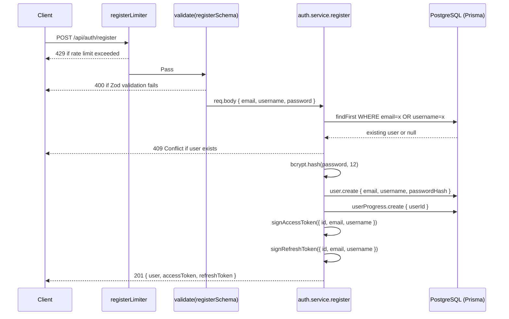
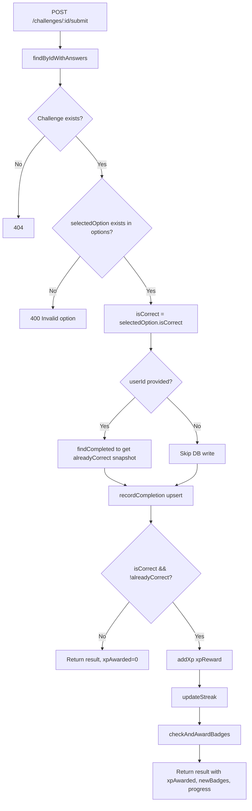
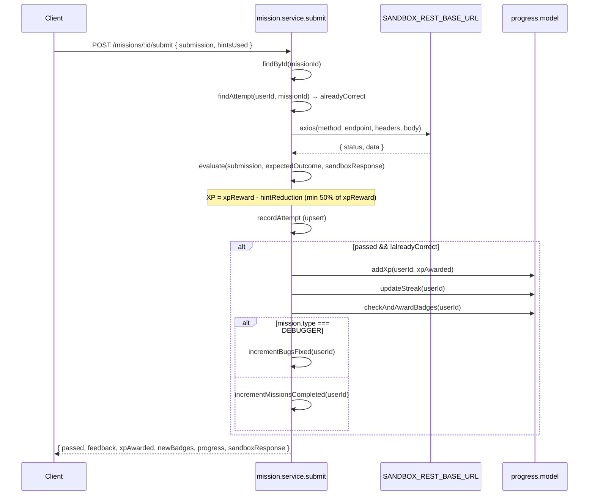

# API Quest — Backend Implementation Details

> Cross-references: [BACKEND_DOCUMENTATION.md](./BACKEND_DOCUMENTATION.md) | [SYSTEM_IMPLEMENTATION.md](../SYSTEM_IMPLEMENTATION.md)

This document describes the internal implementation patterns, business logic rules, and data flow for each backend module. Read [BACKEND_DOCUMENTATION.md](./BACKEND_DOCUMENTATION.md) first for the schema and API reference.

---

## 1. Core Patterns

### asyncHandler

**File:** [`src/utils/asyncHandler.js`](../../backend/src/utils/asyncHandler.js)

```js
const asyncHandler = (fn) => (req, res, next) => {
  Promise.resolve(fn(req, res, next)).catch(next);
};
```

Every controller function is wrapped with `asyncHandler`. This eliminates `try/catch` from all controllers — any thrown error or rejected promise is automatically forwarded to Express's error middleware via `next(error)`.

---

### ApiError

**File:** [`src/utils/ApiError.js`](../../backend/src/utils/ApiError.js)

Custom error class used across all service and controller layers to produce structured, predictable HTTP errors.

```js
throw ApiError.badRequest('optionId is required');      // 400
throw ApiError.unauthorized('Invalid credentials');      // 401
throw ApiError.notFound('Challenge not found');          // 404
throw ApiError.conflict('Username already exists');      // 409
```

---

### Error Middleware

**File:** [`src/middlewares/error.middleware.js`](../../backend/src/middlewares/error.middleware.js)

Catches all errors forwarded via `next(error)`. Resolution order:

| Error condition | HTTP status | Behaviour |
|---|---|---|
| Prisma `P2002` (unique constraint) | 409 Conflict | Duplicate record |
| Prisma `P2025` (record not found) | 404 Not Found | Upsert/update on missing record |
| `ZodError` | 400 Bad Request | Returns all field-level validation errors |
| `ApiError` instance | `error.statusCode` | Uses the error's own status and message |
| Any other error | 500 Internal Server Error | Generic message, original error logged |

---

### Validate Middleware

**File:** [`src/middlewares/validate.middleware.js`](../../backend/src/middlewares/validate.middleware.js)

Factory function that returns an Express middleware for any Zod schema:

```js
router.post('/register', validate(registerSchema), controller.register);
```

Calls `schema.parse(req.body)`. On `ZodError`, throws to error middleware. On success, replaces `req.body` with the parsed/coerced output.

---

### Logger

**File:** [`src/utils/logger.js`](../../backend/src/utils/logger.js)

Custom lightweight logger. Not Winston — built from scratch.

- 4 levels: `error(0)`, `warn(1)`, `info(2)`, `debug(3)`
- Production: only `warn` and `error` are emitted
- Development: all 4 levels emitted
- Format: `[ISO-TIMESTAMP] [LEVEL] message {meta_json}`

---

## 2. Authentication Module

**Files:** [`src/modules/auth/`](../../backend/src/modules/auth/)

### Registration Flow



**Key rules:**
- `findFirst` with `OR [email, username]` — checks both fields in one query
- If `existing.email === email` → error field is "email", else "username"
- A `UserProgress` row is created atomically after the user row (not in a transaction, but immediately after)
- Token payload contains `{ id, email, username }` — no roles or permissions

---

### Login Flow

1. `findUnique` by email — if not found, throw 401 (deliberately vague: "Invalid email or password")
2. `bcrypt.compare(plaintext, hash)` — if mismatch, throw 401 (same vague message)
3. Sign and return new access + refresh token pair
4. No session created; no database writes on login

---

### Token Refresh Flow

1. `jwt.verify(refreshToken, JWT_REFRESH_SECRET)` — throws if invalid or expired
2. `findUnique` by `decoded.id` — ensures the user still exists
3. Sign and return a **new** access + refresh token pair (refresh token rotation)

> [!NOTE]
> There is no token blacklist or revocation mechanism. Tokens are valid until they expire. If a refresh token is compromised, it cannot be invalidated without rotating the `JWT_REFRESH_SECRET`.

---

### Auth Middleware

**File:** [`src/middlewares/auth.middleware.js`](../../backend/src/middlewares/auth.middleware.js)

Two variants:

**`authenticate`** — Required auth. Extracts `Bearer <token>` from `Authorization` header. Verifies against `JWT_ACCESS_SECRET`. Attaches decoded payload to `req.user`. Throws 401 if missing or invalid.

**`optionalAuthenticate`** — Same logic but catches errors silently. Sets `req.user = null` if token is absent or invalid. Used on public routes that enrich responses for authenticated users.

---

## 3. Challenge Module

**Files:** [`src/modules/challenges/`](../../backend/src/modules/challenges/)

### listByConceptSlug

1. `findByConceptSlug(slug)` — resolves concept by slug, then fetches all challenges with options (without `isCorrect`)
2. If `userId` provided: fetch `userProgress` for XP total, fetch `completedChallenges` for completion map
3. Map each challenge with:
   - `isCompleted`: `!!completedMap[ch.id]` (only true if `isCorrect === true`)
   - `isUnlocked`: `userXp >= ch.requiredXp`
4. Challenges ordered by `level ASC, difficulty ASC`

### getById

Returns single challenge with options (no `isCorrect` exposed). Attaches `isCompleted` and `isCorrect` per user.

### submit (Challenge Answer Submission)



**Critical rule:** `alreadyCorrect` is snapshotted **before** the upsert call. This ensures XP is only awarded on the first-ever correct answer per challenge, even if the user re-submits the correct option.

---

## 4. Mission Module

**Files:** [`src/modules/missions/`](../../backend/src/modules/missions/)

### evaluate() — Core Validation Engine

**File:** [`src/modules/missions/mission.service.js`](../../backend/src/modules/missions/mission.service.js)

`evaluate(submission, expectedOutcome, sandboxResponse)` compares the student's submitted HTTP request against the mission's stored `expectedOutcome`. Returns `{ passed, feedback, errorCategory }`.

Checks run in this exact order:

| Step | Check | errorCategory |
|---|---|---|
| 1 | `submission.method` matches `expectedOutcome.method` (case-insensitive) | `WRONG_METHOD` |
| 2 | `submission.endpoint` matches `expectedOutcome.endpointPattern` (exact string or RegExp) | `WRONG_ENDPOINT` |
| 3 | `submission.endpoint` does not match any `expectedOutcome.forbiddenEndpoints` | `FORBIDDEN_ENDPOINT` |
| 4 | All `expectedOutcome.requiredHeaders` keys present with matching values (case-insensitive key/value check) | `WRONG_HEADER` |
| 5 | `submission.body` contains all `expectedOutcome.requiredBodyKeys` (parses JSON string if needed) | `MISSING_BODY_FIELDS` / `INVALID_JSON` |
| 6 | `sandboxResponse.status` is within `expectedOutcome.expectedStatusRange [min, max]` | `WRONG_STATUS` |

If all checks pass: `{ passed: true, feedback: '✅ Mission complete!' }`

**Endpoint hint logic (Step 2):**
- If `endpointPattern` is a string and slashes are the only difference → hint about slashes
- If difference is only plural/singular → hint about REST plural naming conventions

**Status hint logic (Step 6):** Specific educational feedback is pre-written for status codes 401, 403, 404, 405, 415, 422, 429, 500.

---

### submit (Mission Submission)



**XP reduction formula:**
```
hintReduction = hintsUsed <= 1 ? 0 : Math.min((hintsUsed - 1) * 10, floor(xpReward * 0.25))
xpAwarded = passed ? Math.max(xpReward - hintReduction, ceil(xpReward * 0.5)) : 0
```

- First hint is free (no XP penalty)
- Each subsequent hint: -10 XP
- Maximum deduction: 25% of `xpReward`
- Minimum awarded: 50% of `xpReward`

**Sandbox proxy:** The submission is executed against `SANDBOX_REST_BASE_URL` using axios with `validateStatus: () => true` (so 4xx/5xx do not throw). If the sandbox is unreachable, `sandboxResponse = null` and Step 6 (status range check) is skipped.

**`expectedOutcome` hiding:** `getById` strips the `expectedOutcome` field before returning to the client. Only `submit` reads it server-side.

---

### getHint

Returns the hint text at `hintIndex` from `mission.hints` array (JSON). Calculates `xpReduction` for that hint index:

```
xpReduction = hintIndex === 0 ? 0 : Math.min(hintIndex * 10, floor(xpReward * 0.25))
```

This is informational only — actual XP is applied at `submit` time based on `hintsUsed`.

---

## 5. Progress Module

**File:** [`src/modules/progress/progress.model.js`](../../backend/src/modules/progress/progress.model.js)

### addXp(userId, amount)

```js
prisma.userProgress.update({
  where: { userId },
  data: {
    xpTotal: { increment: amount },
    level: Math.max(1, Math.floor((current.xpTotal + amount) / 100) + 1),
  },
});
```

Level formula: `level = Math.max(1, Math.floor(xpTotal / 100) + 1)`

| xpTotal | Level |
|---|---|
| 0–99 | 1 |
| 100–199 | 2 |
| 200–299 | 3 |
| 500+ | 6 |

---

### updateStreak(userId)

Reads `lastActivity` date:

| Condition | Action |
|---|---|
| `lastActivity` is today | No change (already updated today) |
| `lastActivity` was yesterday | `streakCount += 1` |
| `lastActivity` is 2+ days ago | `streakCount = 1` (reset) |
| `lastActivity` is null | `streakCount = 1` (first activity) |

Always sets `lastActivity = now()`.

---

### checkAndAwardBadges(userId)

Reads current `UserProgress` and counts of completed challenges per protocol. Awards any new badges not already in `UserBadge` for this user:

| Badge | Condition |
|---|---|
| `first_blood` | At least 1 correctly completed challenge (any type) |
| `rest_rookie` | At least 1 correctly completed REST challenge |
| `soap_slinger` | At least 1 correctly completed SOAP challenge |
| `graphql_guru` | At least 1 correctly completed GraphQL challenge |
| `century` | `xpTotal >= 100` |
| `legend` | `xpTotal >= 500` |

Returns array of newly awarded badge codes (empty array if none).

---

## 6. Sandbox Module

**File:** [`src/modules/sandbox/sandbox.service.js`](../../backend/src/modules/sandbox/sandbox.service.js)

### proxyRest

1. Constructs URL: `SANDBOX_REST_BASE_URL + path`
2. Calls `axios({ method, url, headers, data: body, validateStatus: () => true, timeout: 10000 })`
3. Returns `{ status, statusText, headers, data, timing: { ms } }`
4. Writes to `SandboxLog` (fire-and-forget — log failure does not affect response)

### proxyGraphQL

1. POST to `SANDBOX_GRAPHQL_BASE_URL` with `{ query, variables }`
2. Returns `{ status, data, timing: { ms } }`

### proxySoap

1. Builds full SOAP XML envelope for operation (`Add`, `Subtract`, `Multiply`, `Divide`) with `intA`, `intB`
2. POST to `SANDBOX_SOAP_BASE_URL` with headers `Content-Type: text/xml`, `SOAPAction: http://tempuri.org/<operation>`
3. If the external SOAP service is unreachable or returns an error, falls back to a **mock response** that performs the arithmetic locally and returns a synthetic SOAP XML response
4. Returns `{ status, data (raw XML string), timing: { ms } }`

---

## 7. Users Module

**File:** [`src/modules/users/user.service.js`](../../backend/src/modules/users/user.service.js)

`getMe(userId)` returns a composite response:
- `User` record (id, email, username, createdAt) — no passwordHash
- `UserProgress` record
- `UserBadge[]` ordered by `earnedAt ASC`
- `completedChallenges` count (where `isCorrect = true`)

---

## 8. Leaderboard Module

**File:** [`src/modules/leaderboard/leaderboard.service.js`](../../backend/src/modules/leaderboard/leaderboard.service.js)

Simple query: `userProgress.findMany({ take: 50, orderBy: { xpTotal: 'desc' }, include: { user } })`

Controller maps to add 1-based `rank` field. No caching implemented.

---

## 9. Concepts Module

**File:** [`src/modules/concepts/concept.service.js`](../../backend/src/modules/concepts/concept.service.js)

- `getAll()` — returns all concepts with `comparisonPoints[]` and challenge count. Ordered by `protocol ASC`.
- `getBySlug(slug)` — returns concept with `comparisonPoints[]` and full `challenges[]` including options. Throws 404 if not found.

