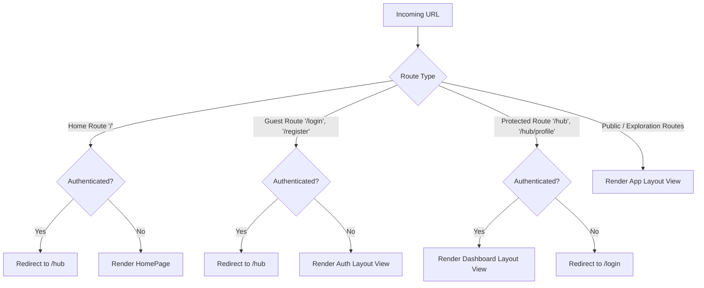
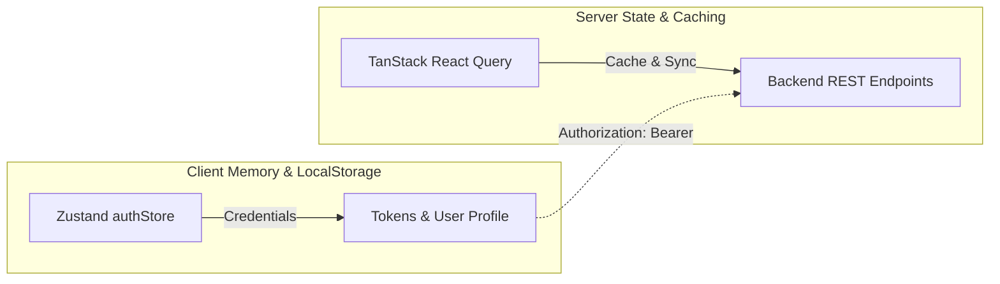
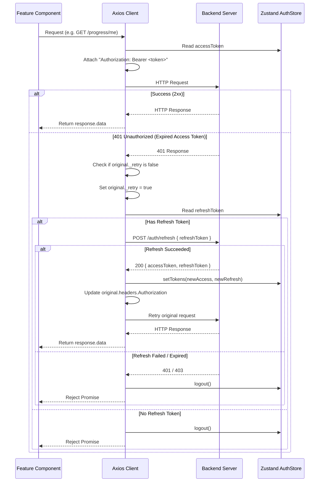

# API Quest — Frontend Documentation

> Cross-references: [FRONTEND_IMPLEMENTATION.md](./FRONTEND_IMPLEMENTATION.md) | [SYSTEM_IMPLEMENTATION.md](../SYSTEM_IMPLEMENTATION.md)

---

## 1. Technology Stack

| Layer / Role | Library / Technology | Version | Purpose |
|---|---|---|---|
| Core Framework | React | ^19.2.8 | UI component framework |
| DOM Renderer | React DOM | ^19.2.8 | DOM reconciliation and rendering |
| Build Tool | Vite | ^8.2.2 | Development server and production bundling |
| Client Routing | React Router DOM | ^7.18.3 | Declarative SPA client-side routing & guards |
| Server State | TanStack React Query | ^5.102.8 | Asynchronous data fetching, caching, deduplication |
| Client State | Zustand | ^5.0.15 | Global lightweight store with `persist` middleware |
| HTTP Client | Axios | ^1.20.0 | Promise-based REST client with interceptors |
| Styling & Theme | Tailwind CSS | ^3.4.19 | Utility-first CSS framework with custom theme tokens |
| Iconography | Lucide React | ^1.37.0 | Clean SVG interface icons |
| Feedback / Alerts | React Hot Toast | ^2.6.0 | Toast notification provider |
| Code Quality | Oxlint | ^1.79.0 | Fast linter |

---

## 2. Project Directory Structure

```
frontend/
├── public/                    # Static assets (logo.png, character.png, apiBackground.jpg, fonts/upheavtt.ttf)
├── index.html                 # Single page application entry HTML shell (includes font preloading)
├── package.json               # Dependencies and build scripts
├── vite.config.js             # Vite configuration with React plugin
├── tailwind.config.js         # Jungle Temple palette, typography (Upheaval, Inter, JetBrains Mono), keyframes
├── postcss.config.js          # PostCSS processor configuration
└── src/
    ├── main.jsx               # Application bootstrap (QueryClientProvider, Toaster, App)
    ├── App.jsx                # Root wrapper rendering AppRouter
    ├── index.css              # Global styles, Tailwind directives, custom component utilities
    │
    ├── app/
    │   ├── queryClient.js     # TanStack QueryClient configuration & defaults
    │   └── router.jsx         # Route declarations, route guard wrappers, layout bindings
    │
    ├── layouts/
    │   ├── AppLayout.jsx      # Public navigation header, footer, container
    │   ├── AuthLayout.jsx     # Full-viewport edge-to-edge layout for Login/Register
    │   └── DashboardLayout.jsx# Authenticated sidebar layout for /hub and /hub/profile
    │
    ├── lib/
    │   └── axios.js           # Central Axios instance with token injection & 401 refresh logic
    │
    ├── components/
    │   ├── ConceptDiagrams.jsx# Interactive / visual protocol diagrams
    │   ├── CookieConsent.jsx  # Privacy and cookie compliance banner & settings modal
    │   ├── PixelIcons.jsx     # Custom retro pixel-art SVGs (badges, locks, swords)
    │   ├── PixelWind.jsx      # Floating animated particle/spore background effect
    │   └── StoneContainer.jsx # Stone-textured arcade UI container wrapper
    │
    └── features/
        ├── auth/              # Authentication & registration
        │   ├── api.js         # Axios endpoints for /auth/login, /auth/register, /auth/refresh
        │   ├── authStore.js   # Zustand store for user identity and JWT credentials
        │   ├── CharacterStage.jsx # Animated/staged character presentation
        │   ├── LoginPage.jsx  # Full-screen responsive login page with honeypot
        │   └── RegisterPage.jsx # Full-screen account registration page
        │
        ├── challenges/        # Quiz & challenge engine
        │   ├── api.js         # Fetch challenges by concept slug and submit answers
        │   ├── ChallengesPage.jsx # Challenge catalog world map & topic selector
        │   └── ChallengePage.jsx  # Individual challenge attempt view
        │
        ├── concepts/          # Knowledge base & protocol learning
        │   ├── api.js         # Fetch concept list and individual concept deep-dives
        │   ├── ConceptsPage.jsx   # Protocol comparison overview
        │   └── ConceptDetailPage.jsx # In-depth technical concept breakdowns
        │
        ├── dashboard/         # Authenticated command center
        │   ├── DashboardHomePage.jsx # Player hub HUD, level progress, active quests
        │   └── ProfilePage.jsx    # User statistics, earned badges, activity history
        │
        ├── home/              # Public landing page
        │   ├── HeroEmblem.jsx # Interactive floating temple emblem with click spark particle burst
        │   └── HomePage.jsx   # Hero section, feature preview cards, arcade showcase
        │
        ├── leaderboard/       # Global competitive rankings
        │   ├── api.js         # Endpoint for top 50 player standings
        │   └── LeaderboardPage.jsx # Ranked leaderboard table with rank medals
        │
        ├── legal/             # Compliance & policies
        │   ├── PrivacyPage.jsx# Privacy disclosure documentation
        │   └── TermsPage.jsx  # Terms of service and usage guidelines
        │
        ├── missions/          # Hands-on interactive API missions
        │   ├── api.js         # Mission catalog, details, hint unlock, and test submit
        │   ├── MissionsPage.jsx   # Mission catalog filtered by difficulty and type
        │   ├── MissionPage.jsx    # Real-time mission editor, proxy executor, response inspector
        │   └── MissionCompleteModal.jsx # Victory dialog displaying XP, coins, and badges
        │
        ├── progress/          # User progress telemetry
        │   ├── api.js         # Fetch current user XP, streak, badges, and stats
        │   └── DashboardPage.jsx  # Detailed personal progress breakdowns
        │
        └── sandbox/           # Live multi-protocol API console
            ├── api.js         # Proxies for REST, GraphQL, and SOAP requests
            └── SandboxPage.jsx# Interactive request builder and response viewer
```

---

## 3. Layout Architecture and Routing

### 3.1 Route Guards

Defined in [`src/app/router.jsx`](../../frontend/src/app/router.jsx):



1. **`HomeRoute`**: Checks `isAuthenticated`. Authenticated players are directed straight to `/hub`. Guests see the public marketing `HomePage`.
2. **`GuestRoute`**: Protects `/login` and `/register`. Logged-in players are redirected to `/hub`.
3. **`ProtectedRoute`**: Protects `/hub` and `/hub/profile`. Unauthenticated visitors are redirected to `/login`.
4. **Catch-all Route (`*`)**: Redirects any unknown route back to `/`.

---

### 3.2 Layout Shells

The application utilizes 3 distinct layout paradigms:

#### 1. `AppLayout` (Public & Explore Navigation)
- **File:** [`src/layouts/AppLayout.jsx`](../../frontend/src/layouts/AppLayout.jsx)
- **Top Navigation Bar:** Sticky header displaying logo, primary navigation links (`/concepts`, `/sandbox`, `/challenges`, `/missions`, `/leaderboard`), dynamic user HUD (XP / player profile pill) or guest CTAs (`Log In`, `Join Temple`), and mobile drawer toggle.
- **Main Outlet:** Dynamic content container.
- **Footer:** Links to learning tracks, legal pages (`/privacy`, `/terms`), cookie configuration triggers, and creator attribution.

#### 2. `AuthLayout` (Full-Screen Immersive Gateway)
- **File:** [`src/layouts/AuthLayout.jsx`](../../frontend/src/layouts/AuthLayout.jsx)
- **Design Philosophy:** Edge-to-edge full-viewport layout (`100vw × 100vh`) with no outer page margins, card borders, or scroll barriers.
- **Background Styling:** Seamless multi-layer linear gradients (`#78b832` to `#143510`), faceted SVG polygon geometric shards, ambient glowing blurs, floating particle spore drift (`PixelWind`), and watermarked anime character illustration backdrop.

#### 3. `DashboardLayout` (Authenticated Command Center)
- **File:** [`src/layouts/DashboardLayout.jsx`](../../frontend/src/layouts/DashboardLayout.jsx)
- **Desktop Sidebar:** Collapsible side rail featuring player avatar initials, online status indicator, grouped navigation links (`HUB`, `EXPLORE`, `COMPETE`), collapse toggle chevron, and bottom logout action.
- **Mobile Top Bar & Drawer:** Responsive header with animated slide-in drawer for smaller screens.
- **Main Area:** Scrollable command center view with embedded mini-footer.

---

## 4. State Management Architecture

The frontend separates client-side state into two primary paradigms:



### 4.1 Client Authentication Store (`authStore.js`)
- **Technology:** Zustand with `persist` middleware.
- **Storage Target:** Browser `localStorage` under key `apiquest-auth`.
- **State Properties:**
  - `user`: `{ id, email, username, createdAt }` or `null`
  - `accessToken`: JWT Bearer string or `null`
  - `refreshToken`: Refresh JWT string or `null`
  - `isAuthenticated`: Boolean flag
- **Actions:**
  - `setAuth(user, accessToken, refreshToken)`: Sets user and tokens, marks `isAuthenticated: true`
  - `setTokens(accessToken, refreshToken)`: Updates tokens after background refresh rotation
  - `updateUser(updates)`: Merges partial profile updates into active user object
  - `logout()`: Clears all authentication state and resets store to defaults

---

### 4.2 Server State Cache (`queryClient.js`)
Configured in [`src/app/queryClient.js`](../../frontend/src/app/queryClient.js):
- `staleTime`: 5 minutes (`1000 * 60 * 5`). Cached queries remain fresh without background refetching for 5 minutes.
- `retry`: 1 automatic retry on query failure.
- `refetchOnWindowFocus`: Disabled (`false`) to eliminate unwanted layout jumps and network overhead during tab switching.

---

## 5. API Integration & HTTP Client

All network communication flows through [`src/lib/axios.js`](../../frontend/src/lib/axios.js):
- **Base URL:** Driven by `import.meta.env.VITE_API_BASE_URL` with fallback to `http://localhost:5000/api`.
- **Default Headers:** `Content-Type: application/json`.

### Interceptor Lifecycle



---

## 6. Theme and Visual Design System

Configured in [`frontend/tailwind.config.js`](../../frontend/tailwind.config.js):

### 6.1 Theme Color Palette (Jungle Temple)

| Palette Family | Hex Codes | Usage |
|---|---|---|
| `moss` | `950: #060d08`, `900: #0a140d`, `800: #112217`, `700: #183020`, `600: #22442e` | Deep background surfaces, headers, card bases |
| `olive` | `900: #122016`, `800: #182c1f`, `700: #203a29`, `600: #2a4b36`, `500: #386348` | Mid-ground panels, borders, secondary elements |
| `emerald` | `400: #34d399`, `500: #10b981`, `600: #059669`, `700: #047857` | Primary accents, success indicators, action buttons |
| `amber` | `400: #fbbf24`, `500: #f59e0b`, `600: #d97706`, `700: #b45309` | XP points, badges, CTAs, highlight badges |
| `stone` | `850: #1a231d`, `800: #232f27`, `750: #2b3a30`, `700: #36473c` | Containers, stone buttons, inset bezels |

### 6.2 Typography Tokens
- `font-pixel`: `"Upheaval"`, `"Upheaval TT"`, `"Upheaval TT -BRK-"`, cursive, monospace (Arcade headings, badges, scores, stats, navigation links, and button labels)
- `font-upheaval`: `"Upheaval"`, `"Upheaval TT"`, `"Upheaval TT -BRK-"`, cursive, monospace (Dedicated arcade game typography token)
- `font-sans`: `Inter`, system-ui, sans-serif (Body text, documentation, descriptions)
- `font-mono`: `"JetBrains Mono"`, Fira Code, monospace (Endpoints, headers, JSON payloads, code blocks)

#### Font Loading & Assets:
- **Upheaval TT (`upheavtt.ttf`)**: Embedded as an optimized Base64 TrueType Data URI inside `src/assets/upheaval.css` and imported directly in `main.jsx` and `index.css`. Also available statically in `/public/fonts/upheavtt.ttf` with preloading in `index.html` via `<link rel="preload" as="font" type="font/ttf" crossorigin />`.
- **Web Fonts**: `Pixelify Sans`, `Press Start 2P`, `Inter`, and `JetBrains Mono` imported from Google Fonts for auxiliary or body text.

### 6.3 Reusable Visual Elements
- **`PixelWind`**: Procedurally places drifting, pulsing pixel particles representing atmospheric spores.
- **`StoneContainer`**: Custom bevel-bordered arcade card with inner shadow and moss gradient.
- **`PixelIcons`**: SVGs crafted for retro pixel-art aesthetic (trophies, keys, swords, locks, scrolls, bolts).

